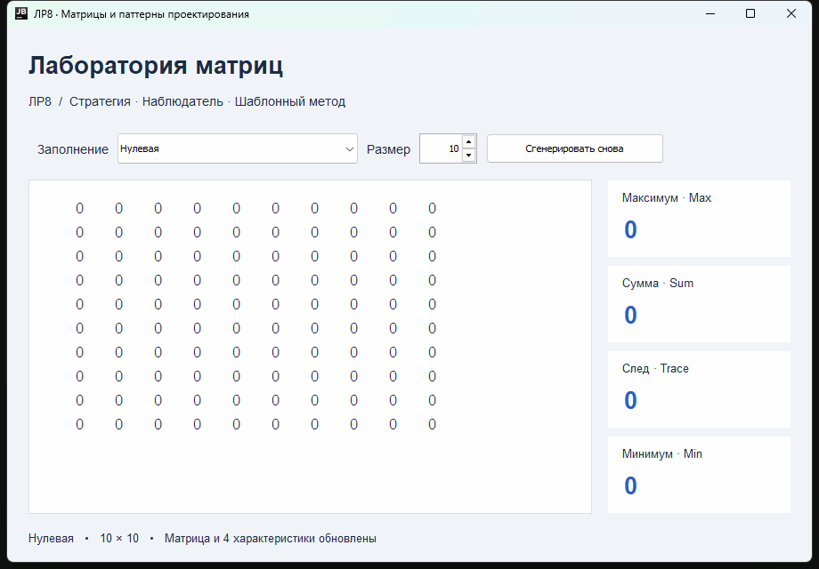

# Лабораторная работа № 8

## Возможности

- Заполнение: нулевая, единичная, диагональная, случайная матрица и случайные числа по краям.
- Дополнительный способ заполнения: шахматная матрица.
- Вычисления: максимум, сумма элементов и след матрицы.
- Дополнительная характеристика: минимум элементов.
- Размер от 1 до 20. Все поля обновляются при выборе типа, изменении размера и повторной генерации.

## Паттерны проектирования

- **Стратегия**: интерфейс `IGenerator` и его реализации задают способы заполнения. Они зарегистрированы в `MatrixData.GENERATORS`.
- **Наблюдатель**: `Matrix` уведомляет реализации `IMatrixListener`, которые обновляют отображение и характеристики.
- **Шаблонный метод**: метод `AbstractTextMatrixListener.matrixUpdated` объявлен `final` и выполняет инициализацию, обход элементов и завершение. Эти шаги реализованы в классах вычислений.

## Файлы

- `src/` — исходный код.
- `dist/MatrixLab.jar` — готовое приложение.
- `demo.gif` — демонстрация работы.
